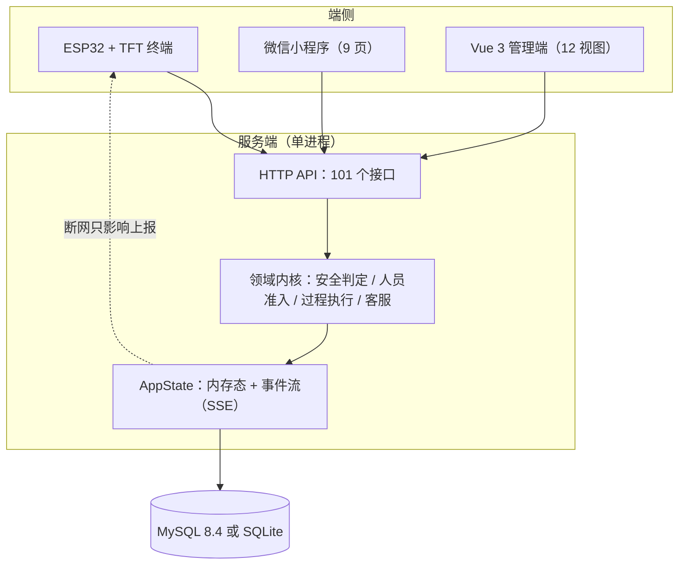

# kitchen-system — 后厨智能调度与食安合规管理系统

[](https://github.com/czm668/kitchen-system/actions/workflows/ci.yml)
[](pyproject.toml)
[](tests)
[](LICENSE)

> 定稿题目《基于 ESP32 的后厨智能调度与食安合规管理系统的设计与实现》
> 从零建立的独立工程 · 2026-11-12 起

把后厨的**安全判定**和**食安台账**做成一套断网也能跑的边缘系统：ESP32 采 12 路信号，
领域内核在**同一帧内**完成燃气/明火/冷链/温湿度的判定与互锁处置，不依赖任何网络调用；
管理端、小程序、TFT 终端三端读同一份事实。

**在线演示**：http://101.37.82.186 （阿里云 1 GiB 试用实例，到期即下线；管理端需口令，
顾客点餐与小程序链路可直接体验。部署过程见 [`deploy/README.md`](deploy/README.md)）

**技术栈**：Python 3.11（运行时零第三方依赖，标准库 `http.server` + 自研 Router）·
MySQL 8.4 / SQLite（可插拔）· Vue 3 + Vite · 原生微信小程序 · Docker Compose

## 它解决什么

| 后厨的真实问题 | 本项目的做法 |
|---|---|
| 燃气泄漏、明火离人、冷链失温——事后才发现 | 12 路信号 1 帧/秒进内核，判定 → 互锁 → 处置在同帧内完成；断网只影响上报，不影响关阀 |
| 食安台账靠手写，溯源查不到批次 | 51 张表覆盖人员准入、过程执行、留样销毁、批次溯源，扫码即可回溯到供应商与效期 |
| 顾客问「我的菜到哪了」只能催服务员 | 小程序看实时进度、催菜直达厨房；智能客服先分意图，能当场办的就不建工单 |

## 架构



判定链按「保护 → 规则 → 互锁 → 入队 → 降级 → 健康监视」串行执行，**帧内不做任何网络 IO**；
存储层是同一套接口的三种实现（内存 / SQLite / MySQL），换库不改业务代码。

## 值得展开的四处设计

1. **帧内零网络 IO**：燃气突变、明火离人的处置不经过任何 HTTP/MQTT 调用，实测燃气与超温
   处置 0.0s、明火离人判定 12s（含视觉 AND 与工位锁），误报 0。网络只用于上报与看板。
2. **三端共享同一份事实**：`AppState` 是唯一事实源，管理端 SSE、小程序轮询、TFT 终端读的是
   同一份快照，不存在「大屏说正常、手机说告警」。
3. **跨重启一致性**：订单是内存态 + 写穿镜像，重启后自增游标会归零并覆盖历史行——启动时
   按库里 `MAX(id)` 对齐游标；事件 `seq` 不重号；断网补传按业务键去重。
4. **可复跑的验收**：`deploy/verify-cloud.sh`（部署后 10 项自检）、`tools/miniapp_cloud_check.py`
   （按 `wx.request` 口径从外网打 24 项）、`tools/ci.py`（单测 + 迁移校验 + 前端契约）。
   不靠「打开看看能用」，每条结论都有命令可复现。

## 规模

| 维度 | 数字 |
|---|---|
| 领域代码 | 103 个模块 / 31,683 行 Python（运行时零第三方依赖） |
| 数据 | 51 张表 · 19 个版本化迁移 · 4 张核心状态机 |
| 接口 | 101 个 HTTP 接口（主路由 65 + 扩展 36） |
| 测试 | 1697 项 pytest，覆盖判定边界、状态机、存储双后端、接口契约 |
| 前端 | Vue 3 管理端 12 视图；小程序 9 页 |
| 部署 | Docker Compose 三容器，阿里云 1 GiB 实测共占 206 MB |

## 文档

完整设计文档见 [`docs/`](docs/README.md)：01 总体架构 · 02 硬件与 GPIO · 03 数据库 ·
04 功能规格与联动阈值 · 05 接口与通信契约 · 06 模拟前端实施方案 · 07 管理端 ·
08 TFT 终端 · 09 小程序 · 10 顾客画像与 AI 客服 · 11 经营账本 · 12 食安合规凭证。
功能—证据—AI 融合槽位的唯一事实源是 [`docs/requirements.json`](docs/requirements.json)，
人读版见 [`docs/功能证据矩阵.md`](docs/功能证据矩阵.md)。

## 快速开始

**唯一生产入口**：`kitchen`（装了 `pip install -e .` 后），或等效的
`python -m kitchen.api.server --static web/dist`。浏览器打开 http://127.0.0.1:8848/。
`tools/demos/` 下全是离线演示脚本，**不是服务入口**——别从那里挑一个跑就以为服务起来了。

```bash
# 1) 单测（1697 项，纯标准库，不装任何依赖）
python -m pytest -q

# 2) 本地 CI：审查守卫 / ruff 语法 / R5 时钟 / 数字 / 单测 / 迁移 / 前端 / 小程序 / PR 体积提示
#    （ruff 未安装时该关打印 SKIP，不伪造通过；pip install -e ".[dev]" 可装上）
python tools/ci.py

# 3) 起服务
pip install -e . && kitchen                 # 或：python -m kitchen.api.server --static web/dist
```

Windows 用户可用 `tools/kitchen.bat`：`serve` 起生产服务、`serve-miniapp` 起小程序临时服务器
（原先 `serve` 名不副实，实际起的是后者，已修正）。更多命令（离线仿真、MQTT 真链路、
TFT 终端、管理端 dev 模式）见下方《快速开始》原文。

## 部署

一键脚本与逐条说明都在 [`deploy/README.md`](deploy/README.md)：`docker-compose.1g.yml` 是
1 GiB 机型的生产口径（MySQL buffer pool 64M、关 performance_schema、40 连接），
`gen-env.sh` 生成口令，`verify-cloud.sh` 做上线自检。文档里同时记了六个只有真跑起来
才会暴露的坑（镜像缺 `cryptography` 导致认证失败、`docker-entrypoint-initdb.d` 只在空卷
执行、`.dockerignore` 排掉 `web/` 却仍返回 200 等）。

## 多融合 AI

七个 AI 场景共用一个可插拔 provider（`guest/llm.py::make_provider`）：配了 key 一起切在线模型，
没配就各自走确定性离线规则，**断网不返回 500**。新增场景只需写一个 `AdvSpec`（提示词 +
分类白名单 + 离线规则），经统一 `run_guarded` 输出同一 `AiResult` 形状并落 `llm_runs` 审计。

- **顾客域**（既有）：画像 `profile`、AI 客服受理 `support`
- **经营域**（既有）：日报点评 `finance_daily`
- **合规域**（既有）：合规日报点评 `compliance_daily`
- **新增三场景**（`src/kitchen/ai/`）：安全异常归因 `anomaly_explain`、派单优先级建议
  `dispatch_hint`、食安合规问答 `compliance_qa`

**六条护栏不因"多融合"放松**：AI 只出建议、必有离线降级、结构化白名单输出、逐次审计、
不喂隐私、可复现。异常归因不关阀、派单建议不下发、合规问答不改门禁——`AiResult` 里
没有 `approve/decision/amount` 字段，派单/关阀/门禁/退款仍由规则与权限层裁决。

管理端 `GET /api/ai/overview` 一屏聚合七场景的调用/降级/版本；`POST /api/ai/advise/*`
请求建议（`ai.read` 全员可读面板，`ai.advise` 限组长及以上防刷模型）。守卫与场景清单见
`docs/requirements.json`，`tests/test_ai_fusion.py` 钉死护栏与边界。

## 已知边界

> 逐条功能的证据类型（真机 / 半实物 / 仿真 / 单测）与"需求状态、AI 融合槽位"见
> [`docs/功能证据矩阵.md`](docs/功能证据矩阵.md)，机器可读单一数据源是
> [`docs/requirements.json`](docs/requirements.json)。当前仍在开题阶段，17 条功能**尚待老师确认**；
> 学校明确"功能基本不删、主要增加 AI 融合"，新增 AI 需求时按矩阵的统一接入规则落到对应槽位，
> 不靠改 README 宣称来追。**AI 场景"已落地"仅指建议层已实现，不等于对应硬件已真机验证。**

- **硬件未整机装配**：驱动、三通道互锁、失联降级都有单测与仿真回放，但没有一块焊好的板子。
- **视觉模型部分验证**：`weights/kitchen.pt` 为 6 类轻量模型（person / hat / mask / uniform /
  cigarette / phone），best.pt 验证 **mAP50-95=0.643、mAP50=0.927**，其中 **4 类有验证集，
  uniform 与 phone 无独立验证样本**（`ap_class_index=[0,1,2,4]`）。明火/离人判定链路是通的，
  演示时用脚本注入检测结果，**不声称已通过厨房场景实测**。
  指标的**唯一数据源**是 [`docs/vision_model_metrics.json`](docs/vision_model_metrics.json)
  （内容锚点溯源到 `var/train.log`，不靠脆弱行号）；
  `python tools/vision_model_report.py` 打印可辩护报告、`--check` 校验自洽，
  `tests/test_vision_model_report.py` 钉死"不许给无验证样本的类编造 AP"
  （含 overall mAP = validated 各类均值的强等式校验）。
- **云部署边界**：MySQL 8.4 单实例，1 GiB 机型参数调优，已验证跨重启持久化与每日备份；
  不是高可用生产集群。在线 demo 为 HTTP + 裸 IP，无域名、无 HTTPS。
- **小程序未发正式版**：试用实例开不了备案服务号，缺备案域名 + HTTPS；开发模式与真机预览可用。
- **支付未接入**：客诉补偿只生成凭证与审批记录，不对接支付渠道。

## 许可

仅供个人学习与技术交流，**不授权商业使用**；也请不要把整体或实质部分拿去当毕业设计、
课程设计或竞赛作品提交。完整条款见 [`LICENSE`](LICENSE)。

## 工程缘起（开发笔记）

这里是**新选题唯一的开发目录**。旧的 `毕设项目/02_项目代码/proj/` 不再改动，降级为**只读素材库**——
里面 644 个文件中有 400 个是旧选题资产（明厨亮灶场景、厨师帽数据集、旧页面验收脚本），
把新代码继续写在里面只会越写越乱。

新工程只做两件事：**写新选题自己的代码**，**按清单从旧目录取可复用的素材**。

## 目录

本工程位于毕设项目根 `kitchen-system/` 的 `02_项目代码/` 下，层级与旧 `毕设项目/` 对齐：

```
kitchen-system/                     ← 毕设项目根（文档 + 代码分开）
├── 00_从这里开始.md                 导航入口
├── 00_总索引.md                     进度与目录树
├── 00_原始资料/
├── 01_选题与开题文档/
├── 02_项目代码/
│   └── kitchen/                    ← 代码工程（本文件所在）
│       ├── src/kitchen/               新选题业务代码（唯一开发地）
│       │   ├── manifest.py                场景契约加载 + 13 类信号唯一事实源
│       │   ├── channels.py                执行对象映射与三通道互锁
│       │   ├── sim.py                     13 类信号注入引擎（曲线 / hold / 游走 / 事件回放）
│       │   ├── device.py                  kitchen-only 模拟器状态机
│       │   ├── drivers/                   12 遥测驱动 + 三通道 / 独立 GPIO 执行驱动
│       │   ├── safety/                    安全判据与互锁编排（领域算法，A2-02 起）
│       │   │   ├── gas.py                      燃气基线 / 突变率两级处置 / 明火放宽 / 周更固化
│       │   │   ├── flame.py                    视觉注入 / 明火离人工位锁 / 返岗刷卡 / 失联降级
│       │   │   ├── coldchain.py                开门波动过滤（波形识别）+ 冷链/留样柜前置层
│       │   │   └── interlock.py                判定 → 三通道编排：触发源登记 / 动作去重 / 人工恢复
│       │   ├── staff/                    人员准入域（A3-01 起，不接规则引擎）
│       │   │   ├── models.py                   五张表实体 + 拒绝码字典 + 晨检问卷与门限
│       │   │   ├── repository.py               内存仓储，复刻唯一键/外键（换卡留痕、同日晨检覆盖）
│       │   │   ├── admission.py                刷卡五道门 / 问卷 / 双通道复核 / 资质候选 / 每日扫证
│       │   │   └── duty.py                     在场积分 → 未授权上岗告警（5 秒去抖、只开一张单）
│       │   ├── process/                  过程执行域（A4-01 起，不接规则引擎）
│       │   │   ├── models.py                   订单/子项状态机、菜品配方 SOP、工位、占用会话、过程事件
│       │   │   ├── repository.py               静态资料内存仓储（菜品/配方/SOP/工位/供应链）
│       │   │   ├── orders.py                   建单/推进/事件重放/幂等/乐观锁/沽清/退菜
│       │   │   ├── dispatch.py                 #4 上灶占用、点火校验、交期优先派单、排风监测、资质改派
│       │   │   ├── cooking.py                  #12 称重判定与锁定、#13 SOP 分步、出餐门禁
│       │   │   ├── retention.py                #14 留样清单/称重 125g + #6 的 48h 销毁任务与推送
│       │   │   ├── disinfection.py             #15 消毒会话门控、累计曲线、复消工单与禁出库
│       │   │   ├── trace.py                    供应链溯源一屏（批次/供应商/检测）+ 出库门禁 + 标签
│       │   │   └── qr.py                       纯标准库二维码编码（byte/M/v1~v10），标签打印用
│       │   ├── vision/                   视觉域（A5-01 起，输入形态是帧流，不依赖其它域）
│       │   │   ├── models.py                   检测框/人员状态/违规类型/「哪类切电」
│       │   │   ├── stream.py                   MJPEG 真机 / 目录回放 / 内存 / 合成帧源 + 看门狗
│       │   │   ├── detector.py                 YOLOv8（惰性依赖）+ 脚本假检测（离线可测）
│       │   │   ├── postprocess.py              检测框 → 人员状态（ROI 归属 / 穿戴匹配 / 正向证据优先）
│       │   │   ├── violations.py               跨帧去抖 3 帧 1.5s → 违规事件（离岗立即清零）
│       │   │   ├── evidence.py                 多图抓拍 + sha256 + 模型版本，可验签
│       │   │   ├── disposal.py                 #16 切工位插座 → 语音 → 双通道复核 → 恢复 → 工单
│       │   │   ├── absence.py                  #11 连续离岗 → 未开火转派（已开火只报组长接手）
│       │   │   ├── link.py                     #3 视觉接线（按工位算人数，离线不喂）
│       │   │   └── pipeline.py                 一帧一调主循环 + 视觉被遮挡判定
│       │   ├── resilience/               异常兜底域（A6-01 起，不依赖其它域）
│       │   │   ├── queue.py                    有界落盘队列：seq 跨重启不重号、关键记录不因容量丢
│       │   │   ├── guards.py                  三条保守保护（燃气突变/超温联动/长烧无人），不经规则引擎
│       │   │   ├── upload.py                   批量补传 + (device_id,seq) 去重 + 时钟校准
│       │   │   ├── health.py                   卡死/超量程/心跳丢失 → 故障工单 → 超时升级
│       │   │   ├── degrade.py                  三端降级标记（同一份事实，三种排版）
│       │   │   └── offline.py                  装配层：保护→引擎→互锁→入队，tick() 无网络 IO
│       │   ├── api/                      管理端 API（A7-01 起，标准库 HTTP，零三方依赖）
│       │   │   ├── auth.py                     四角色九权限 + 令牌签名 + 登录锁定（默认拒绝）
│       │   │   ├── accounts.py                 账号表（KITCHEN_ACCOUNTS 可覆盖）+ 口令哈希
│       │   │   ├── audit.py                    操作留痕（含被拒绝的动作）
│       │   │   ├── routes.py                   65 条主路由（扩展 36 条在 *_api.py，合计 101 个 HTTP 接口）
│       │   │   ├── views.py                    只读视图（订单/甘特/遥测/工单/KPI/参数…）
│       │   │   ├── actions.py                  写动作（下单/派单/通道/阈值/配方版本/注入）
│       │   │   ├── state.py                    AppState 门面：装配六域 + 线程安全快照
│       │   │   ├── sse.py                      SSE 事件流（snapshot + 增量，200 条上限）
│       │   │   ├── customer.py                顾客通道（A9）：桌台令牌/归属隔离/催菜限频/通知
│       │   │   └── server.py                   ThreadingHTTPServer + 静态托管 + SPA fallback + 溯源 PNG
│       │   ├── tft/                      后厨 TFT 终端（A8，模拟版与固件同构）
│       │   │   ├── screens.py                 核心 4 屏帧模型（结构契约，LVGL/文本同源）
│       │   │   ├── render.py                  帧 → 60x22 文本帧（离线红框/10 行截断）
│       │   │   ├── audio.py                   DFPlayer 语音编号表（001~012）+ 播报模拟
│       │   │   └── terminal.py                终端状态机（轮询/刷卡/工序/离线缓冲/恢复同步）
│       │   ├── domain.py                 跨域基础件：CST 时区 / 日期解析 / 领域异常族
│       │   ├── sqlseed.py                 种子 SQL 解析（阈值与人员同源，避免两份数据漂移）
│       │   ├── rules/                     规则引擎（八项能力，A2-01）
│       │   │   ├── model.py                    Rule / Condition / 边界与比较符 + 装载期校验
│       │   │   ├── window.py                   滑动窗口聚合（median/mean/rise/rate/std）
│       │   │   ├── state.py                    闩锁状态 + JSON / NVS 两种持久化
│       │   │   ├── engine.py                   一帧判定：持续时长、档位、宽限、闩锁、复位、判据合并、工单去重
│       │   │   ├── loader.py                   env_thresholds 行 → Rule（脏数据装载期报错）
│       │   │   ├── schedule.py                 档位时段表（跨零点 / 重叠检测 / 下次切换）
│       │   │   └── config_store.py             端侧配置缓存（档位表+阈值+动作语义，sha256，损坏降级）
│       │   ├── runtime.py                 端侧运行时：装配顺序 + tick() 一处出结果（A2-03）
│       │   └── hal/                       硬件抽象层（接真机时只换这一层）
│       │       ├── pins.py                    GPIO 分配表 + 约束校验（ADC2/仅输入/flash/strapping）
│       │       ├── adc.py                     衰减档量程、两点校准、电阻分压与推荐
│       │       └── frontend.py                MQ-2 / 火焰 / SCT-013 / HX711 → 契约量纲
│       ├── scenarios/kitchen.json     场景契约（12 遥测 + 9 动作）
│       ├── migrations/                数据库迁移 001–019（底座 13 表 + 本工程 6 个版本，共 51 表）
│       │   ├── 001–013                    取用自旧工程，sha256 记在 BASELINE.json，内容未改
│       │   ├── 014_kitchen_core.sql       本工程正式版（旧工程同名文件是草案）
│       │   └── BASELINE.json              基线校验和，防止回头改已执行的迁移
│       ├── fixtures/
│       │   ├── kitchen_sim_profiles.json  演示注入曲线与事件时间线
│       │   ├── kitchen_rules.json         场景级规则补充（动作建议/闩锁/多源交叉/文案/工单）
│       │   ├── kitchen_config_default.json 端侧内置默认配置（由种子 + 档位表派生，勿手改）
│       │   ├── vision_dataset.yaml        视觉数据集配置（names 顺序 = 模型 class id）
│       │   └── seed_kitchen.sql           种子数据（工位/菜品配方SOP/员工工牌/监测点阈值）
│       ├── firmware/esp32cam/         ESP32-CAM MJPEG 推流（草图，未编译；引脚表+供电规范）
│       ├── tests/                     1697 条单测（含 MQTT 链路 6 条、调度器 9 条、prod 安全 4 条）
│       │   └── fixtures/qr_golden.json    二维码基准哈希（满容量用例由 segno 逐掩码比对确认）
│       ├── tools/
│       │   ├── legacy.py                  旧目录素材取用器（list / fetch / verify / check）
│       │   ├── migrate.py                 迁移校验链（check / sqlite / list / json）
│       │   ├── gas_demo.py                #1 燃气分级处置离线演示（四段场景全跑）
│       │   ├── hood_demo.py               #2 排烟分档调度离线演示（压缩一天，4 次切档）
│       │   ├── flame_demo.py              #3 明火离人离线演练（离人→联锁→刷卡→视觉掉线）
│       │   ├── coldchain_demo.py          #5/#6 冷链与留样柜（开门过滤→分级→工单）
│       │   ├── interlock_demo.py          互锁编排（三源共用排风 / 优先级压制 / 人工恢复）
│       │   ├── p2_dashboard.py            P2 一屏复盘（温湿度/排烟/燃气/冷链/互锁）
│       │   ├── staff_demo.py              A3 人员准入（扫证拦截→刷卡→问卷→复核→未授权告警）
│       │   ├── order_flow_demo.py         A4 一单全链路（下单→派单→上灶→称重→SOP→出餐）
│       │   ├── compliance_demo.py         A4 合规闭环（留样→48h销毁→消毒复消→溯源标签→派单改派）
│       │   ├── vision_demo.py             A5 视觉闭环（去抖→切电→证据链→复核→离岗转派→接#3）
│       │   ├── vision_train.py            数据集类别顺序校验 + 训练指令生成（不训练）
│       │   ├── vision_model_report.py     YOLO 指标单一数据源 → 可辩护报告（--check 自洽）
│       │   ├── gen_vision_scenarios.py    生成 6 个视觉时序剧本夹具（去抖/遮挡/离岗）
│       │   ├── cam_check.py               摄像头节点自检（帧间隔/大小/时间戳/头尾完整）
│       │   ├── resilience_demo.py         A6 异常兜底演练（断网/掉电/传感器坏/三端降级 10 段）
│       │   ├── web_check.py               A7 管理端验收自检（构建产物/8 页链路/21 写接口/29 项）
│       │   ├── tft_demo.py               A8 TFT 终端九段全链路（新单/刷卡/工序/断网/恢复/出餐）
│       │   ├── miniapp_check.py           A9 顾客小程序验收（工程/契约/越界/全链路 46 项）
│       │   ├── soak_test.py               A10 稳定性压测（7 项判定 + 内存收敛）
│       │   ├── experiment.py              A10 三组对比实验（仿真数据 → 报告）
│       │   ├── build_config.py            由 seed + 场景规则重建端侧内置配置
│       │   └── sim_cli.py                 离线自检 CLI
│       ├── legacy_sources.json        复用台账：旧目录路径 + 15 个素材包 + 禁取清单
│       ├── vendor/                    取用下来的素材落点（只读，勿手改）
│       └── pyproject.toml
├── 03_设计文档/
├── 04_生成脚本/
└── 05_系统记录/
```

**管理端前端**（`02_项目代码/kitchen/web/`，Vue3 + ECharts，8 页）

```
web/
├── index.html
├── package.json / vite.config.js     dev 期 /api 代理到 8848；ECharts 单独 chunk
└── src/
    ├── main.js / App.vue             自研 hash 路由外壳（不引 vue-router，无需服务端 fallback）
    ├── api/client.js                 令牌 / 超时 / 统一错误；401 广播踢回登录页
    ├── api/stream.js                 SSE + 断线重连 + 退化为轮询
    ├── stores/auth.js                会话与权限（can(perm)）
    ├── stores/live.js                overview 快照 + 事件流 + 400ms 合并刷新
    ├── components/                   Icon / ChartPanel（ECharts 按需）/ DegradeBanner / StatCard / ConfirmDialog / ToastHost
    ├── views/                        8 个页面 + LoginView（kpi / orders / stations / environment / recipes / compliance / tickets / control）
    └── utils/                        format.js（展示口径唯一出口）/ chart.js（主题取色）
```

## 快速开始

> 在**代码工程根**执行。本机开发用的是便携版 Python（`python311._pth` 模式，`-m` 不会
> 自动加当前目录），所以示例统一用变量 `PY` 指解释器；换成系统的 `python` 同样可行。

```bash
PY="python"     # 本机便携版：D:/liulan1/毕设/.local/python311/python.exe
cd "02_项目代码/kitchen"

# 跑全部单测（1697 条）
# MQTT 真链路演示（A2）：python tools/demos/mqtt_demo.py --amqtt
"$PY" -m pytest -q

# 本地 CI（A7）：一条命令验全部（pytest + 迁移校验 + web_check + miniapp_check）
# Windows 双击可用：tools\kitchen.bat（ci / test / serve / backup 四个子命令）
"$PY" tools/ci.py

# 离线自检：13 类信号、排烟升温曲线、RFID 与三通道 ack 回放
"$PY" tools/sim_cli.py --seconds 40
"$PY" tools/sim_cli.py --json --seconds 40
```

## 跑稳定性压测与对比实验（A10）

```bash
"$PY" tools/soak_test.py --minutes 1    # 快速验证（7 项判定）
"$PY" tools/soak_test.py --minutes 120  # 答辩前夜挂 2 小时长跑
"$PY" tools/experiment.py --write       # 三组对比实验 → 05_系统记录/ 对比实验报告.md
```

## 跑顾客端小程序（A9）

`miniapp/project.config.json` 已填测试用途 AppID `wxe9190b8ab70df245`
（非工具测试号 `touristappid`，可真机预览）。**最省事：双击
`tools/start_kitchen_demo.bat`——自动起后端（没起才拉起）+ 自动打开
开发者工具载入 miniapp**。服务没起也可一键自愈：
`python tools/miniapp_netcheck.py --fix`（新开最小化窗口拉起，关窗=停）。
页面报「网络不可用」时先跑 `python tools/miniapp_netcheck.py` 做四层体检
（端口/回环/局域网/代理），它会直接打印根因和修复命令。

三条命令分三个场景：

```bash
# 场景 1：开发者工具模拟器（只绑 127.0.0.1）
python tools/miniapp_check.py --serve

# 场景 2：手机真机预览 —— 绑 0.0.0.0 并打印本机局域网 IP
python tools/miniapp_check.py --serve --lan
#   把脚本打印的地址填进 miniapp/config.js 的 BASE_URL，例如
#   const BASE_URL = 'http://192.168.2.246:8848';
#   手机与电脑同一 WiFi；Windows 防火墙放行 TCP 8848 入站；
#   若报域名错，手机端开发版打开「调试模式」。

# 场景 3：只跑验收，不起服务
python tools/miniapp_check.py        # 46 项（含 AppID 格式/非占位断言）
python tools/miniapp_netcheck.py     # 网络体检（报「网络不可用」时先跑这个）
```

微信开发者工具导入 `miniapp/` 目录即可（AppID 自动读 project.config.json），
「详情 → 本地设置」勾选「不校验合法域名」。正式/体验版发布必须换 HTTPS 备案
域名并在小程序后台登记 request 合法域名，见 `03_设计文档/09_顾客端小程序设计.md` §7.3。
**AppSecret 不要写进 miniapp/**：前端代码包可反编译，只放服务端环境变量。

## 跑 TFT 终端演示（A8）

```bash
cd "02_项目代码/kitchen"
"$PY" tools/demos/tft_demo.py          # 九段全链路：上线→新单→刷卡→工序→断网→恢复→出餐
"$PY" tools/demos/tft_demo.py --quiet  # 只看结论
```

## 跑管理端（A7）

```bash
cd "02_项目代码/kitchen"

# 1) 验收自检（构建产物 / 8 页数据链路 / 21 个写接口，共 29 项）
"$PY" tools/web_check.py

# 2) 起服务（同时托管构建产物；浏览器打开 http://127.0.0.1:8848/）
"$PY" -m kitchen.api.server --port 8848 --static web/dist --time-scale 60

# 3) 改前端时用 dev 模式（/api 代理到 8848，改完即刷）
cd web && npm run dev            # http://127.0.0.1:5173

# 4) 出构建产物
cd web && npm run build          # → web/dist（约 745KB / gzip 258KB）
```

演示账号：`admin`（管理员）/ `lead01`（组长）/ `chef01`（厨师）/ `guest`（只读），
默认口令 `kitchen2026`（生产必须用 `KITCHEN_ADMIN_PASSWORD` 或 `KITCHEN_ACCOUNTS` 覆盖）。

> **本机构建坑**：esbuild 收尾时删不掉自己写在 `%TEMP%`（8.3 短名）里的临时文件，
> 报 `Access is denied` 导致构建失败。把临时目录指到普通路径即可：
> `TEMP=D:/.../.local/tmp/web-build TMP=$TEMP npm run build`。

## 从旧目录取素材

```bash
# 1) 看有哪些可复用的包（按 CORE / ADAPT / PORT 分区）
"$PY" tools/legacy.py list
"$PY" tools/legacy.py list --zone CORE

# 2) 先预览，不写盘
"$PY" tools/legacy.py fetch platform-bus --dry-run

# 3) 真取用：按素材库原始相对路径落到 vendor/proj/，并记账 sha256
"$PY" tools/legacy.py fetch platform-bus

# 4) 校验（本地是否被改、素材库是否更新）
"$PY" tools/legacy.py verify
"$PY" tools/legacy.py check          # CI 自检，退出码 0/1
```

15 个素材包对应差距文档 §1.1 的 12 行复用判定：

| 分区 | 含义 | 包 |
|---|---|---|
| `CORE` | 直接复用 | `platform-bus`、`plugin-host`、`command-engine`、`readings-db`、`auth-audit-ws`、`api-core`、`platform-contracts`、`regression-baseline` |
| `ADAPT` | 要改造 | `rules-engine`、`alarms`、`vision-pipeline`、`web-shell`、`simulator` |
| `PORT` | 拷贝改造 | `sensor-drivers`（DHT11 / MQ-2 采样）、`prelabel-tool` |

**取用的三条纪律**

1. 取来的是**只读素材**。要改造，先复制进 `src/kitchen/` 再改；`fetch` 发现本地被改过会拒绝覆盖（除非 `--force`）。
2. `FROZEN` 分区一律禁取：`datasets/chef_hat/`（473 MB 旧数据集）、`.verify/`、`scenarios/mingchu.json`、
   `plugins/lab_safety/`、旧厨师帽脚本。护栏在 `legacy_sources.json` 的 `must_block` 里逐条自检。
3. 单文件 > 20 MB、单包 > 500 个文件直接拒绝，防止一口气把前端依赖树或训练数据拖进来。

## 当前进度

| 项 | 状态 |
|---|---|
| P0 契约与数据模型 | ✅ `scenarios/kitchen.json` + 13 类信号口径 + 三通道映射冻结 |
| P1/T1 信号注入 | ✅ 12 遥测 + 1 类 RC522 事件，曲线 / hold / 游走 / 确定性回放 |
| P1/T2 执行映射 | ✅ 6 动作 × 4 通道防串路、互锁优先级、CH3 失效安全与双通道复核 |
| P1/T1+T2 迁移 | ✅ 从旧工程迁入并按新包名重组，25 条原单测全部保留并通过 |
| 模拟前端 HAL | ✅ `hal/` 三模块 + 70 条单测；MQ-2 分压、SCT-013 分辨率、火焰极性、ADC2 约束全部落成可执行校验，见 `03_设计文档/06_模拟前端实施方案.md` |
| 新工程自带层 | ✅ 场景契约加载器（加载期校验）、kitchen-only 模拟器、素材取用器 |
| #1 燃气判定 | ✅ 基线 + 突变率两级 + 明火放宽 + 周更固化（`tools/demos/gas_demo.py`） |
| #2 排烟分档 | ✅ 三档时段表 + 端侧配置缓存 + 温升 OR 判据 + 清理工单（`tools/demos/hood_demo.py`） |
| #3 明火离人 | ✅ 视觉 AND 火焰 + 工位锁 + 返岗刷卡 + 失联降级（`tools/demos/flame_demo.py`） |
| #5/#6 冷链与留样柜 | ✅ 分级超限 + 120 秒确认 + 开门波动过滤（`tools/demos/coldchain_demo.py`） |
| #7 温湿度联动 | ✅ level=0 只联动排风，与 #1/#2 共用 CH2 |
| 互锁编排（A2-08） | ✅ 三源共用排风 / 优先级压制 / 全部恢复才关 / 人工确认留痕（`tools/demos/interlock_demo.py`） |
| P2 一屏复盘 | ✅ `tools/p2_dashboard.py`（CLI 版；真看板在 A7） |
| #8 晨检准入（A3-02） | ✅ 五道门 + 问卷 + 当日锁定 + 组长双通道复核（`tools/demos/staff_demo.py`） |
| #9 健康证拦截（A3-03） | ✅ 按日期判定 + 每日扫描置 expired + 拦截当日排班 |
| #10 资质匹配后台（A3-04） | ✅ 候选集四条件（启用/资质/证件/晨检）+ A4-09 已接进派单 |
| #11 未授权上岗告警（A3-05） | ✅ 在场积分 + 5 秒去抖 + 只开一张单（`staff/duty.py`） |
| 订单状态机（A4-01） | ✅ 状态按子项推算 + 事件流重放 + 幂等 + 乐观锁（`process/orders.py`） |
| #4 灶台占用派单（A4-02） | ✅ 派单/占用/点火三层 + 交期优先 + 全忙排队 + 排风监测（`process/dispatch.py`） |
| #12 配菜称重（A4-03） | ✅ ±5% 判定（小料按 ±1g）+ 锁下一步 + 重称覆盖（`process/cooking.py`） |
| #13 SOP 分步（A4-04） | ✅ 按序确认 + CCP 出餐门禁 + 刷卡身份留痕（`process/cooking.py`） |
| #14 留样称重（A4-05） | ✅ 当日批次清单 + 扫码/批次号 + 125g 门限 + 达标才落库（`process/retention.py`） |
| #15 消毒复消（A4-06） | ✅ 会话门控 + 100~120℃ 累计 600s + 超温/超时 + 复消关单解禁（`process/disinfection.py`） |
| #6 的 48h 销毁（A4-07） | ✅ 到期开单 + 小程序推送 + 幂等 + 演示 48h→1min（`process/retention.py`） |
| 供应链与溯源（A4-08） | ✅ 溯源码→批次/供应商/检测一屏 + 出库门禁 + 自研二维码标签（`process/trace.py` / `qr.py`） |
| 派单资质联调（A4-09） | ✅ `StaffMatcher` + 不符自动改派 + 上灶复校（`process/dispatch.py`） |
| 视觉帧源（A5-01） | ✅ MJPEG 按 FFD8/FFD9 切帧 + 时间戳单调化 + 看门狗（`vision/stream.py`） |
| 视觉判定（A5-02） | ✅ 框→人员状态 + 跨帧去抖 + 正向证据优先（`vision/postprocess.py`）；6 类模型权重已入库，指标见 `docs/vision_model_metrics.json`（4 类有验证集） |
| 证据链（A5-03） | ✅ 多图 + sha256 + 元数据，可验签（`vision/evidence.py`） |
| #16 违规处置（A5-04） | ✅ 行为类切电/着装类只语音 + 双通道复核 + 最短 10s（`vision/disposal.py`） |
| #11 离岗转派（A5-05） | ✅ 离岗 12s → 未开火转派；已开火只报组长接手（`vision/absence.py`） |
| #3 真实视觉（A5-06） | ✅ 按工位算人数 + 离线不喂（`vision/link.py`） |
| #17 端侧队列（A6-01） | ✅ 有界落盘 + seq 跨重启不重号 + 关键记录不丢（`resilience/queue.py`） |
| #17 补传去重（A6-02） | ✅ 批量补传 + 唯一键去重 + 冲突单独报 + 时钟校准（`resilience/upload.py`） |
| #17 三条保守保护（A6-03） | ✅ 燃气突变/超温联动/长烧无人，不经规则引擎（`resilience/guards.py`） |
| #17 传感器故障工单（A6-04） | ✅ 卡死/超量程/心跳丢失 → 工单 → 超时升级（`resilience/health.py`） |
| #17 三端降级（A6-05） | ✅ 同一份事实三种排版，逐条点名不可用能力（`resilience/degrade.py`） |
| #17 端到端装配（A6） | ✅ `tick()` 内无网络 IO，断网只影响上报（`resilience/offline.py`） |
| 管理端壳与鉴权（A7-01） | ✅ 自研 hash 路由 + 四角色九权限 + 登录锁定（`web/` + `api/auth.py`） |
| 后厨 TFT 终端（A8-02~06） | ✅ 模拟版全链路：4 屏帧模型 + 离线缓冲/恢复同步 + DFPlayer 编号表 + cooking 5 条 API（`tft/`，`tools/demos/tft_demo.py` 九段）；真机等板子（设计文档 08 §六） |
| 顾客端小程序（A9-01~07） | ✅ 模拟版全链路：顾客通道 7 条 API + `miniapp/` 原生 3 页（`miniapp_check.py` **46 项**）；**11/13 测试用途 AppID 已填 + 手机真机预览链路打通**（设计文档 09 §7.1~7.2）；正式发布等 H4（§7.3） |
| 联调/演示/验收（A10-01~07） | ✅ 软件侧收口：三端联调测试 5 条（抓 2 真 bug）+ `soak_test.py` 7 项（12000 帧内存收敛）+ 演示脚本/录屏分镜 + 对比实验三组（燃气/超温 0.0s、明火离人 12.0s、误报 0）+ 注入演示角标 + 答辩问答 13 问；录屏与真机长跑待人工/硬件 |
| 订单与调度（A7-02） | ✅ 实时订单流 / 派单 / 催菜置顶 / 沽清（`views/OrdersView.vue`） |
| 工位甘特（A7-03） | ✅ ECharts `custom` 按真实起止画段 + 转派留痕 + 上灶/释放（`views/StationsView.vue`） |
| 环境与设备（A7-04） | ✅ 12 路曲线 + 三通道状态机（`views/EnvironmentView.vue`） |
| 配方与工艺（A7-05） | ✅ 配方/SOP/CCP + **版本化另存**（`views/RecipesView.vue`） |
| 批次与资质（A7-06） | ✅ 四页签 + 刷卡准入自检（`views/ComplianceView.vue`） |
| 工单中心（A7-07） | ✅ 三类合流 + 超时列 + 消毒类禁手关（`views/TicketsView.vue`） |
| KPI 看板（A7-08） | ✅ 四项口径随数据下发 `note`（`views/KpiView.vue`） |
| 远程控制与参数（A7-09） | ✅ 输动作名二次确认 + 阈值按行提交 + 演示值↔真实值对照（`views/ControlView.vue`） |
| 前端契约测试（A7） | ✅ 静态扫描接口路径/图标名 + 真 payload 字段核对（`tests/test_api_web_contract.py`） |
| P1 T3–T8、硬件驱动 | ⬜ 待开工 |
| M0 平台底座接入 | ⬜ 用 `fetch` 取 CORE 包后按新分层接入 |

原 369 条旧工程回归不受影响——旧目录一行未改。

## 硬规则（会出错的地方）

1. **CH1 燃气阀 / CH2 排风 / CH3 工位插座是三个不同执行对象**。动作名不同、通道不同，
   映射层 `channels.py` 会硬拦截跨通道下发。旧场景的 `valve_close/valve_open` 禁止带入。
2. **13 类信号 = 12 个遥测 + 1 类 RC522 事件**。遥测 id 与 `scenarios/kitchen.json` 必须完全一致，
   `manifest.py` 在加载期强校验，写错名字直接报错。
3. **恢复动作必须人工确认**；CH3 还要 Web + TFT 双通道复核；断网降级期间禁止自动恢复。
4. **不手改 `vendor/`**，不把旧目录塞进 `sys.path`——新工程要能脱离旧目录独立打包。
5. **互锁的触发源必须是 `rule_id`，不能是 `anonymous`**。三个功能先后开排风、只恢复了一个，
   `anonymous` 会在通道上合并成一个源，于是风机在燃气还在漏的时候被关掉（`safety/interlock.py`）。
6. **事件型动作不做状态去重**：`voice_play` 每次都要播，`alarm_light_on` 才按状态去重。
   把 `voice_play` 加进 `EVENT_ACTIONS` 之外的去重逻辑，等于「报警只响第一次」。
7. **#15 的所有判定只在 `state='running'` 会话内做**。`env_thresholds` id=9 是 `range 100~120`，
   常温 25℃ 一进去就命中「低于下限」——不消毒时一直报警，现场必然把点关掉，真消毒时也不报了。
8. **二维码不许引第三方库**（`process/qr.py` 纯标准库）。溯源标签要能离线打印，
   「先联网装个包」不是可接受的前提；改这个模块必须先跑 `tests/test_qr.py` 的基准比对。
9. **摄像头必须独立 5V/2A 供电，绝不接工位插座**。#16 切的就是工位插座，
   跟着取电就变成「一断电就瞎 → 拍不到整改画面 → 双通道复核凭人嘴说」。
10. **视觉只切行为类（吸烟/玩手机），着装类只语音**。没戴帽子戴回来要 3 秒，
    断插座不影响他戴帽子，却让整条线停摆——现场的处理方式是去遮摄像头。
11. **按工位算人数，不按整幅画面**（`vision/link.py`）。2 米外的服务员路过不能让
    灶前的火变成「有人看着」；按全画面人数的版本在两灶后厨里永远不触发。
12. **烹饪中的菜不转派**（`vision/absence.py`）。炒到一半换人等于重做，
    锅里东西没人认账；离岗时只报「需组长接手看火」。
13. **`seq` 必须跨重启不重号**（`resilience/queue.py`）。服务端去重键是
    `(device_id, seq)`，掉电重启后序号归零会让服务端把**新数据**当成「已收到的旧数据」
    静默丢掉——表现是补传成功、页面缺一段、日志全绿。所以除了每条记录，压缩时还要把
    `last_seq` 写进侧车 `.state`：只存队列最大 seq 不够，全 ack 后队列空了，最大值就没了。
14. **`tick()` 里禁止网络 IO**（`resilience/offline.py`）。`#1` 确认窗口 30 秒、`#3` 12 秒，
    而 HTTP 超时默认 3~10 秒；同步上传会把采样间隔拉到十几秒，保护还在但窗口全乱。
    补传走独立的 `flush()`，由调用方的上报循环调。
15. **补传冲突 ≠ 重复**（`resilience/upload.py`）。同 seq 同内容静默 ack；同 seq **不同内容**
    说明端侧 seq 被复用，是真 bug：冲突记录不 ack、保留在队列、本轮停止补传。
    当作重复 ack 掉，丢的是数据本身，而且丢得无声无息。
16. **三条保守保护只在跃迁时产出事件，回落必须产出 `EVENT_RELEASED`**（`resilience/guards.py`）。
    漏了释放事件，互锁通道的触发源永不注销，`restore()` 一直返回「还有触发源没恢复」——
    现场表现是**阀关了再也打不开**，只能重启设备。
17. **配方改版一律「另存新版本」**（`api/actions.save_recipe_version`）。订单创建时快照了
    `recipe_id`；原地改会让「正在做的单」和「刚下的单」按两套配料称重——同一个菜两个标准，
    两个都不合格。新版本号取**最大 +1**，不是「当前启用 +1」（停用 v3、启用 v2 时会撞上 v3）。
18. **阈值只提交改过的行与字段**（`views/ControlView.vue` + `actions.save_params`）。
    `PUT /api/params` 按 `id` 合并；整表提交会把别人刚改的那行用本地旧值覆盖回去，
    两个人同时维护阈值时必然丢失修改且没有任何提示。
19. **降级文案只在一处生成**（`resilience/degrade.py` → `components/DegradeBanner.vue`）。
    各端自己拼文案必然出现「Web 说设备离线 / TFT 说网络异常 / 小程序说数据更新中」，
    加一项降级要改三处、漏两处。三端只负责渲染同一份事实。
20. **`TelemetryRing` 的 `deque` 必须持锁读写**（`api/state.py`）。采样线程 `append`、
    请求线程遍历会抛 `RuntimeError: deque mutated during iteration`——曲线页偶发 500，
    且只在「正好在采样」的那一刻复现，本地几乎抓不到。
21. **`emit()` 的 body 不许用 `kind` 做键名**（`api/state.py` + `api/actions.py`）。`_emit()`
    先放 `kind` 再展开 body，body 里的 `kind` 会把事件种类覆盖掉——本阶段 cooking 事件
    全部漏播就是这么来的。用 `op`。同理别用 `seq`/`ts`/`time` 做业务键。
22. **TFT 离线只缓冲不裁决**（`tft/terminal.py`）。判定永远在服务端；离线刷卡走白名单
    弱校验（未知卡/证无效**红拒不入队**）；恢复回放 4xx 业务拒绝不重试（记 denied +
    播报 006），5xx 留队列。**语音编号只追加不改号**（固件与 SD 卡绑定）。
23. **顾客通道零业务逻辑**（`api/customer.py`）。下单/催菜全部转发给 `OrderService`，
    顾客令牌**不是**登录令牌（访问员工接口一律 401）；催别人的单回 **404 不回 403**
    （403 等于告诉陌生人「这单存在但不是你的」）。
24. **`ApiServer.stop()` 只能停 serve 过的服务**（`api/server.py`）。`make_server`
    起的服务没跑 `serve_forever`，对它调 `stop()` 会**永久阻塞**（`shutdown()` 等一个
    不会到来的循环）。测试里要真 HTTP 就 `start()`/`stop()` 配对，否则都走 Router 直调。
25. **联调测试要看字段级一致，不是接口通**（`tests/test_integration_threeway.py`）。
    单端测试全绿也可能字段对不上（TFT 队列屏 item_id 恒 None 就是这么漏的）。
    同时**别把有界缓冲当泄漏**：遥测环 600 点/事件环 500 条/补传队列 2000 容量
    按容量封顶，内存判定要预热到容量满、并排除业务数据增长（`tools/soak_test.py`
    的口径注释）。

## 跟旧工程的关系

| | 旧 `proj/` | 新 `kitchen-system/` |
|---|---|---|
| 角色 | 只读素材库 + 旧选题回归基线（369 passed） | 新选题唯一开发地 |
| 内容 | 644 文件：CORE 130 / ADAPT 61 / PORT 3 / NEW 16 / FROZEN 400 / PARKED 34 | 只放新代码，78 个源文件 + 55 个测试文件 + 44 个前端文件（web 25 + miniapp 19） |
| 改动 | **零删除、零移动、零修改** | 全部新增 |
| 关系 | 被 `tools/legacy.py` 按需取用 | 不运行时依赖旧目录 |

分区口径的完整依据见 `毕设项目/04_系统记录/20261112_代码复用性整理清单.md`。
